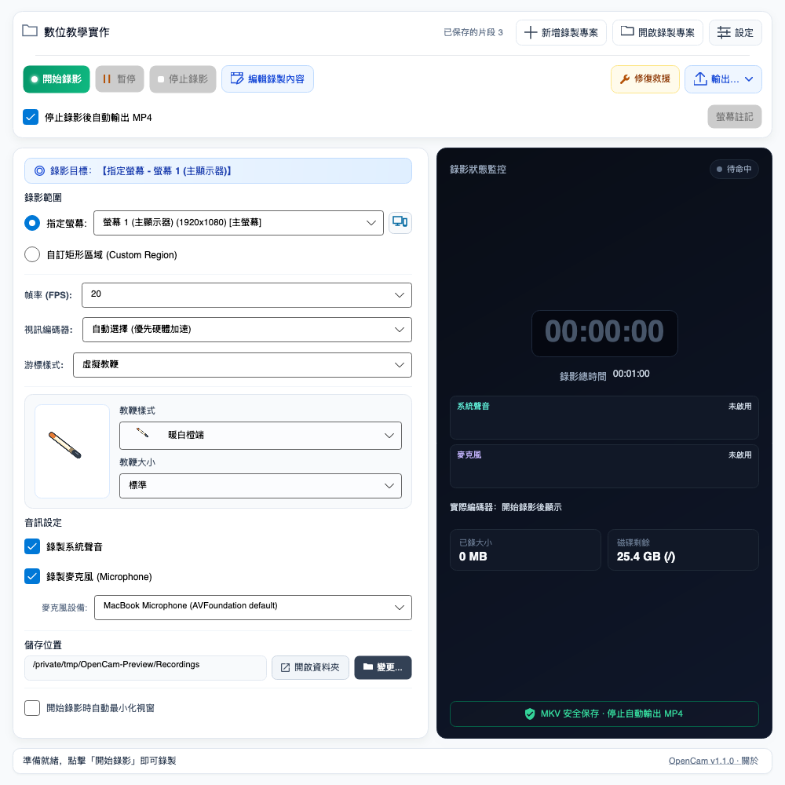
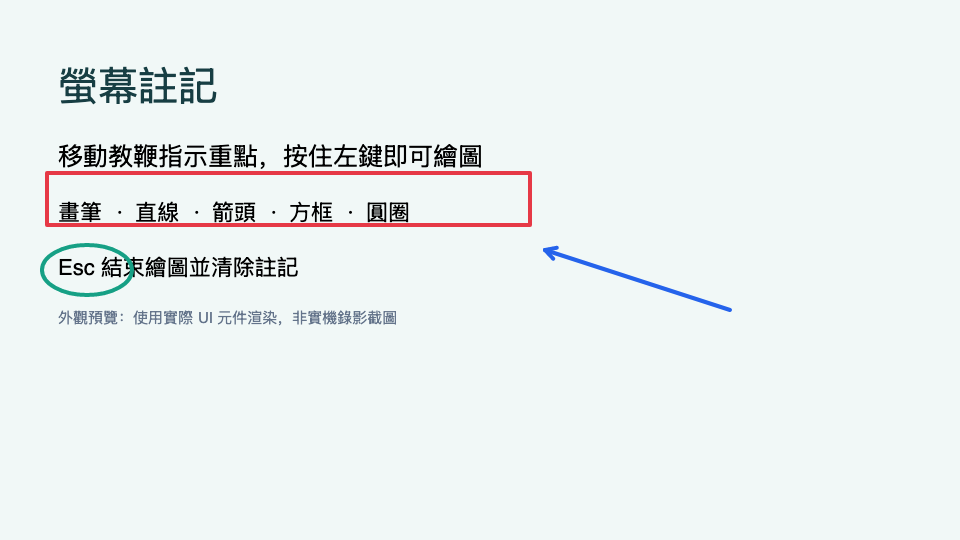
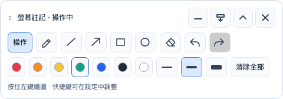
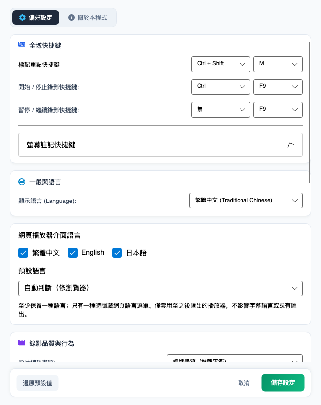
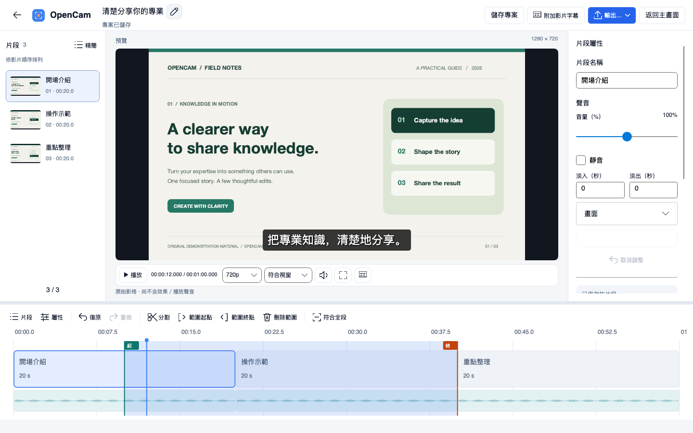
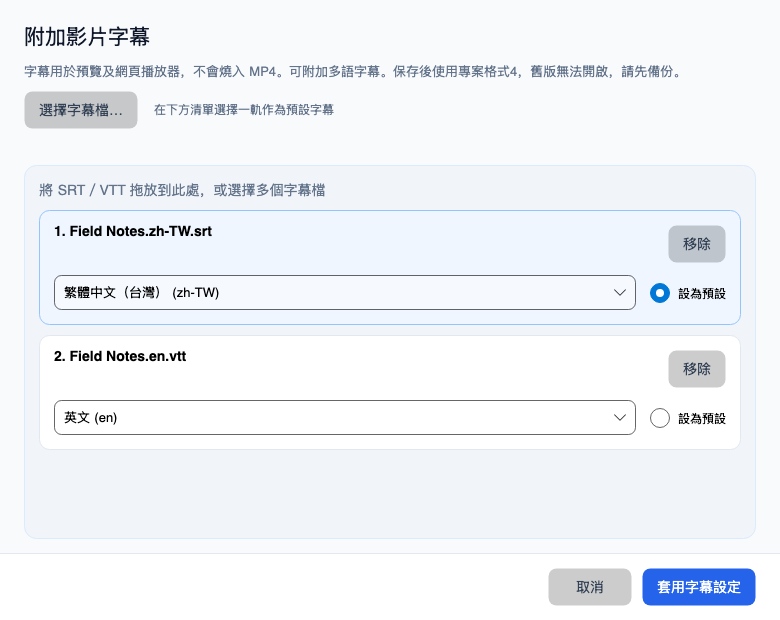
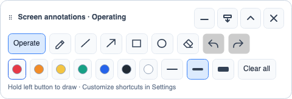

# OpenCam（螢幕錄影工具）

[English](#english) ｜ [官方網站](https://kaoshou.github.io/OpenCam/) ｜ [下載最新版](https://github.com/kaoshou/OpenCam/releases/latest) ｜ [完整使用說明](docs/USER_GUIDE.zh-TW.md)

OpenCam 是 Windows 與 macOS 桌面螢幕錄影工具，讓你錄影、剪輯，再繼續錄影。錄影片段與剪輯保存在可重開的專案中，需要時可輸出 MP4、GIF 或附帶章節與字幕的網頁播放器。

## v1.1.0 更新重點

- **螢幕註記**：錄影時使用畫筆、直線、箭頭、方框與圓圈標示內容，可調整顏色和粗細，並提供橡皮擦、復原、重做與清除。
- **可自訂快捷鍵**：操作畫筆、工具列與繪圖工具；註記直接錄入影片，並固定在螢幕位置。
- **教鞭選擇介面**：樣式與大小集中顯示，方便預覽教鞭。

上一版 v1.0.0 的主要更新：

- **重大更新：OBS 錄影核心**。Windows 與 macOS 改用 OBS／libobs，針對舊流程效能不足、影音不同步與實際 FPS 偏低造成的卡頓改善擷取與音畫時間軸；實際效果仍依硬體、解析度及負載而異。
- **虛擬教鞭**：四種樣式與三種大小，尖端對準指示位置，直接錄入影片，方便製作數位教材。

- 網頁播放器新增閱讀設定浮層：字級、行距、深色高對比與暖白背景，預設關閉，不擠壓逐字稿閱讀空間。
- 可下載所選語言的完整閱讀版 HTML 或純文字 TXT，支援離線閱讀、列印及選擇是否包含時間標記。
- 改善播放器鍵盤操作、焦點提示、字幕設定關閉操作，以及手機、平板橫直向版面。
- 官方網站與使用說明改善鍵盤導覽、文字對比及窄螢幕排版。

[完整更新內容](docs/releases/v1.1.0.md) ｜ [歷史版本](https://github.com/kaoshou/OpenCam/releases)

## 主要功能

- **螢幕與區域錄影**：錄製全螢幕、指定顯示器或自訂矩形區域，提供螢幕編號辨識、5／10／20／30／40 FPS（首次啟動預設 20 FPS）與游標效果。
- **螢幕註記**：錄影中以畫筆、直線、箭頭、方框和圓圈標示內容，調整顏色與粗細，支援橡皮擦、復原、重做及自訂快捷鍵。
- **OBS 核心錄影**：Windows 使用 Windows Graphics Capture，macOS 使用 ScreenCaptureKit；不使用 GDI／FFmpeg 錄影備援。FFmpeg 保留於聲音試錄、預覽、剪輯與匯出。
- **系統聲音與麥克風**：獨立開關音源，查看各自的即時音量，錄製前可試錄及回放確認聲音。可選關閉確認、僅開始錄影時確認（預設），或開始及暫停恢復時都確認；另可啟用麥克風連續無聲 30 秒提醒。
- **專案與繼續錄影**：命名、儲存、重開專案，暫停後編輯，或在既有內容上追加錄影。
- **影片剪輯**：片段排序、修剪、分割、合併、群組、刪除範圍、復原／重做與改名；可調整音量、靜音、淡入淡出、裁切、縮放及位置。
- **預覽與重點標記**：可調整畫質與預覽大小、全螢幕播放及拖曳定位；錄影時按「標記重點」或快捷鍵（預設 Ctrl+Shift+M），稍後在編輯器定位、改名或刪除。
- **多語字幕與搜尋**：匯入 SRT／VTT，切換字幕語言及外觀；網頁播放器提供逐字稿搜尋、關鍵字標示與點擊跳轉。
- **多種輸出**：整個影片或單一片段可輸出 MP4／GIF；整部影片也可輸出為離線網頁播放器。可設定停止後自動輸出 MP4。
- **錄製內容保存**：原始影片以 MKV 分段保存，剪輯不覆寫素材；提供中斷救援、磁碟空間提醒及錄影中的關閉保護。
- **硬體編碼**：支援 NVIDIA NVENC、Intel QSV、AMD AMF 與 Apple VideoToolbox，並提供 CPU 編碼。
- **匯出品質**：選擇 MP4 或網頁播放器後，可選保留目前設定、標準壓縮或較小檔案，以及原始／最高 1080p／最高 720p。記住上次選擇，保留比例且不放大；壓縮需重新編碼，檔案大小依內容而異。停止後自動輸出仍沿用原設定。
- **繁體中文、英文與日文介面**：時間軸片段右鍵也提供更改名稱、刪除及 MP4／GIF 匯出。

## 下載與安裝

| 平台 | 系統需求 | 下載選項 |
| --- | --- | --- |
| Windows | Windows 10／11，x64 | Setup 安裝版、Portable 免安裝版 |
| macOS | macOS 13 以上，Apple Silicon／arm64 | DMG；不適用 Intel Mac |

到 [最新 Release](https://github.com/kaoshou/OpenCam/releases/latest) 下載。套件包含 .NET Runtime 與媒體工具。Windows 錄影所需的 Microsoft Visual C++ 執行階段隨套件附上，不需另外安裝或尋找 DLL。

- **Windows 安裝版**：執行 `OpenCam_v1.1.0_Windows_x64_Setup.exe`。
- **Windows 免安裝版**：完整解壓 `OpenCam_v1.1.0_Windows_x64_Portable.zip`，保留同資料夾的所有檔案，再執行 `OpenCam.exe`。
- **macOS**：打開 `OpenCam_v1.1.0_macOS_arm64.dmg`，將 OpenCam 拖入「應用程式」。首次使用時，在「系統設定 → 隱私權與安全性」允許螢幕／系統音訊錄製及麥克風權限；變更權限後可重新啟動程式。
- 此版未提供 Windows 發行者簽章或 Apple Developer ID 公證，首次開啟可能出現安全性提示。請先確認來自本專案官方 Releases；macOS 可參閱 [Apple 的安全開啟說明](https://support.apple.com/zh-tw/102445)。不要停用系統防護；若提示檔案損毀或惡意內容，請停止開啟並回報。

## 開始使用

1. 選擇螢幕或錄影範圍、系統聲音與麥克風。
2. 按「開始錄影」，建立或使用目前專案，依聲音檢查與準備狀態開始錄製。
3. 錄影中可暫停、繼續及標記重點；暫停並保存片段後可開啟編輯器。
4. 完成後停止錄影，可自動輸出 MP4，或稍後透過「輸出…」選擇 MP4、GIF、網頁播放器。
5. 若只需要其中一段，在片段清單或時間軸按右鍵，移至「匯出片段…」再選擇格式。

儲存專案與輸出影片是不同操作。請保留整個專案資料夾（包含錄影片段、字幕及重點資料），不要只搬移 `project.opencam`。有字幕的專案使用格式 4，v0.3.3 及以前無法開啟；字幕不燒入 MP4／GIF，也不會自動調整時間。

網頁輸出包含 `index.html`、`media.mp4` 與 `opencam-player.js`，請一起搬移或上傳。GIF 沒有音訊；長影片或原始解析度需要較多轉換時間與暫存磁碟空間。相容完整片段可快速輸出，裁剪與效果等操作可能需要重新轉檔。

## 熟悉的使用方式：快速上手

OpenCam 結合 oCam 簡單易用的錄影概念，以及 EverCam 製作數位教材的工作流程。以下提供相近體驗的設定方式，讓熟悉這兩款工具的使用者快速上手。

### oCam 使用者：錄完自動產出影片

oCam 是輕巧好用、錄完即產出影片的工具。若希望類似體驗，勾選「停止錄影後自動輸出 MP4」，停止後等待自動輸出完成；亦可手動匯出 GIF（沒有音訊）。OpenCam 另外保留專案與 MKV 原始素材，方便續錄及編輯。

### EverCam 使用者：分段教學與剪輯

1. 錄製前新增錄製專案，命名並確認保存位置。
2. 游標樣式選「虛擬教鞭」，再選樣式與大小。
3. 開始錄影，可暫停／繼續，或停止後再開始，程式自動分段。
4. 「編輯錄製內容」可分割、合併、修剪、重排，並匯入多重 SRT／VTT 字幕。
5. 輸出 MP4 或含章節、字幕與逐字稿的網頁播放器。

教鞭提供暖白橙端、藍綠銀白、圓頭短棒與高對比黑金，各可選較小／標準／加大。效果直接錄入影片，事後不能更換；正式講解前先短錄並回放，確認畫面、聲音與同步。上述是相近工作流程，不代表與 oCam／EverCam 專案格式相容或具關聯。

oCam、EverCam 名稱及相關商標屬各自權利人所有；此處僅作使用方式說明，無合作或背書關係。

## 介面預覽

以下以 v1.1.0 程式介面與示範資料製作，點選圖片可查看原尺寸。

## 授權

OpenCam 自有原始碼採 [GNU Affero General Public License v3.0 或後續版本](LICENSE)（AGPL-3.0-or-later）。版權與原始碼資訊見 [NOTICE.md](NOTICE.md)；FFmpeg、.NET Runtime、字型及其他元件適用各自授權，詳見 [第三方聲明](THIRD-PARTY-NOTICES.md) 及套件內附文件。

軟體依「現狀」提供。錄製時請遵守適用的隱私、保密與著作權規範。

---

## English

[Official website](https://kaoshou.github.io/OpenCam/) | [Download latest](https://github.com/kaoshou/OpenCam/releases/latest) | [User guide](docs/USER_GUIDE.en-US.md)

OpenCam is a desktop screen recorder for Windows and macOS. Record, edit, and continue recording in a project you can save and reopen, then export MP4, GIF, or a Web player with chapters and captions.

### What's new in v1.1.0

- **Screen annotations**: draw with a pen, lines, arrows, rectangles and ellipses while recording. Choose colors and line widths, erase whole marks, undo, redo or clear.
- **Customizable shortcuts** for drawing and the toolbar. Annotations are recorded into the video and remain fixed to the screen.
- **Improved teaching pointer controls** with a visible style preview.

Highlights from v1.0.0:

- **Major update: OBS recording core** on Windows and macOS. OBS/libobs replaces the previous recording pipeline to address A/V synchronization, low achieved FPS and stutter. Actual performance still depends on hardware, resolution and load.
- **Virtual teaching pointers**: four styles, three sizes and a precise tip hotspot, recorded directly into teaching videos.

- A closed-by-default reading settings overlay adds text size, spacing, dark contrast and warm backgrounds without shrinking the transcript.
- Download the complete selected-language transcript as standalone HTML or plain TXT for offline reading and printing, with optional timestamps.
- Improved player keyboard navigation, focus indicators, caption-menu dismissal and phone/tablet portrait and landscape layouts.
- Improved keyboard navigation, text contrast and narrow-screen layout on the website and user guides.

[Full release notes](docs/releases/v1.1.0.md) | [Previous releases](https://github.com/kaoshou/OpenCam/releases)

### Features

- **Screen and region capture**: Record a whole screen, selected display or custom rectangle, with display identification, 5/10/20/30/40 FPS (20 FPS on first launch) and cursor effects.
- **OBS-core recording**: Windows Graphics Capture on Windows and ScreenCaptureKit on macOS, without GDI/FFmpeg recording fallback. FFmpeg remains for audio trials, preview, editing and export.
- **System audio and microphone**: Enable each input independently, view separate live levels, and check sound through a trial and replay. Choose audio checks off, at recording start only (default), or at both start and resume. Optional reminders warn after 30 seconds of microphone silence.
- **Projects and continued recording**: Name, save and reopen projects, edit after pausing, and append new recordings.
- **Video editing**: Reorder, trim, split, merge, group, delete ranges, undo/redo and rename clips. Adjust volume, mute, fades, crop, scale and position.
- **Preview and bookmarks**: Adjust quality/size, play fullscreen and scrub. Mark important moments while recording using the button or shortcut (default Ctrl+Shift+M), then seek, rename or delete them in the editor.
- **Multilingual captions and search**: Import SRT/VTT, select language/appearance, and search transcripts with highlighting and click-to-seek in Web exports.
- **Export options**: Export the whole video or a selected clip as MP4/GIF, or the whole video as an offline Web player. Optional automatic MP4 export on stop.
- **Recording preservation**: Keep original MKV segments while editing, with interruption recovery, disk-space reminders and close protection during recording.
- **Hardware encoding**: NVIDIA NVENC, Intel QSV, AMD AMF and Apple VideoToolbox, with CPU encoding available.
- **Export quality**: After selecting MP4 or Web player, choose Keep current settings, Standard compression or Smaller file, with original/up to 1080p/up to 720p resolution. The last choice is remembered; aspect ratio is preserved without upscaling. Compression re-encodes and size depends on content. Automatic export on stop retains its existing settings.
- **Traditional Chinese, English and Japanese interfaces**: Timeline clip context menus also offer Rename, Delete and MP4/GIF export.

### Download and install

| Platform | Requirements | Downloads |
| --- | --- | --- |
| Windows | Windows 10/11, x64 | Setup installer or Portable ZIP |
| macOS | macOS 13+, Apple Silicon/arm64 | DMG; not for Intel Macs |

Download from the [latest Release](https://github.com/kaoshou/OpenCam/releases/latest). Packages include .NET Runtime and media tools. The required Windows Microsoft Visual C++ recording runtime is bundled app-locally; no separate runtime installation or DLL download is needed.

- **Windows installer**: Run `OpenCam_v1.1.0_Windows_x64_Setup.exe`.
- **Windows portable**: Fully extract `OpenCam_v1.1.0_Windows_x64_Portable.zip`, keep all companion files together, then run `OpenCam.exe`.
- **macOS**: Open `OpenCam_v1.1.0_macOS_arm64.dmg` and drag OpenCam into Applications. Allow screen/system-audio recording and microphone access in System Settings → Privacy & Security. Restart OpenCam after changing permissions if needed.
- This version does not provide Windows publisher signing or Apple Developer ID notarization, so first launch may show a security warning. Confirm the download came from this project's official Releases; see [Apple's safe-opening guidance](https://support.apple.com/en-us/102445) on macOS. Do not disable system protection. Stop and report warnings about damaged files or malware.

### Getting started

1. Choose the recording display/region and audio inputs.
2. Select Start Recording, create or use the current project, and follow the audio-check/preparation status.
3. Pause, resume or add bookmarks while recording. Open the editor after pausing and saving a segment.
4. Stop to export MP4 automatically, or use Export… later for MP4, GIF or Web player.
5. To export one clip, right-click it in the clip list or timeline and hover Export clip… to choose a format.

Saving a project does not export a video. Keep the entire project folder, including recordings, subtitles and bookmarks, rather than moving only `project.opencam`. Captioned projects use format 4, incompatible with v0.3.3 and earlier. Captions are not burned into MP4/GIF or automatically retimed.

Web exports contain `index.html`, `media.mp4` and `opencam-player.js`; move or upload them together. GIF has no audio, and long videos or original-resolution exports require more time and temporary disk space. Compatible complete clips can use fast export, while trims and effects may require rendering.

### Familiar workflows: quick start

#### For oCam users: record to MP4

For a familiar record-to-file workflow, enable **Auto-export MP4 on stop**, then wait for export to finish after stopping. GIF export is also available without audio. OpenCam additionally preserves the project and original MKV media for editing and continued recording.

#### For EverCam users: segmented teaching videos

1. Create and name a recording project before recording.
2. Choose **Presentation stick** in cursor styles, then select its style and size.
3. Start recording, pause/resume freely, or stop and start again. OpenCam creates segments automatically.
4. Open **Edit recording** to split, merge, trim and reorder clips, and import multiple SRT/VTT subtitle tracks.
5. Export MP4 or a Web player with chapters, captions and transcripts.

Choose Warm ivory, Teal silver, Round short stick or High-contrast gold in Small, Standard or Large. Pointers are recorded into the video and cannot be replaced afterwards. Make a short test and check picture, sound and synchronization first. These workflows do not imply project-format compatibility or affiliation with oCam/EverCam.

### Interface preview

These illustrations show the v1.1.0 interface with demonstration data. Select an image to view full size.

### License

OpenCam-owned source code is licensed under the [GNU Affero General Public License v3.0 or later](LICENSE) (AGPL-3.0-or-later). See [NOTICE.md](NOTICE.md) for copyright/source information and [THIRD-PARTY-NOTICES.md](THIRD-PARTY-NOTICES.md) plus the bundled notices for FFmpeg, .NET Runtime, fonts and other components.

The software is provided as is. Follow applicable privacy, confidentiality and copyright laws when recording.
